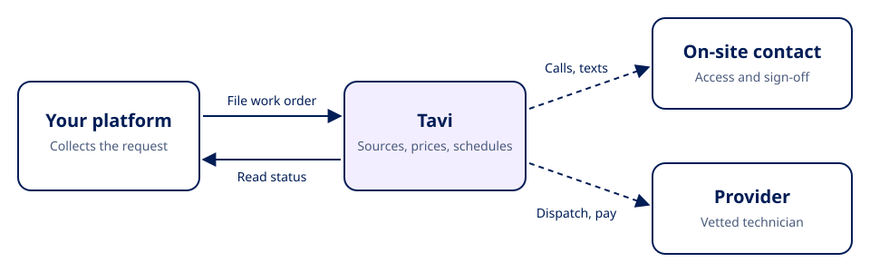

Tavi handles commercial maintenance for multi-site businesses: plumbing, electrical, HVAC, handyman and locksmith work. You send Tavi a work order. Tavi triages it, finds and vets a provider, agrees the price, schedules the visit, coordinates with the people on site, and pays the provider. You read the work order back at any time to see where it stands.

## How it works

1. **Add your sites.** Create each site once with its address, or let Tavi set them up for you during onboarding.
2. **File a work order.** Send the site, the trade, a description of the problem, a deadline and a do-not-exceed price. Name the on-site contact Tavi should call or text.
3. **Tavi does the work.** Tavi sources and vets providers, collects quotes, schedules the visit and coordinates directly with the on-site contact by phone and text.
4. **Follow progress.** Read the work order to see its status, sourcing progress, quoted price, scheduled visits and, when the work is done, the on-site sign-off with photos.

## What the API covers

| You can | Endpoint |
| --- | --- |
| Create and list sites | `POST /api/v1/locations/client/`, `GET /api/v1/locations/` |
| File a work order | `POST /api/v1/jobs/client/` |
| Add photos or files to a work order | `POST /api/v1/attachments/upload/job/{job_id}` |
| List work orders | `GET /api/v1/jobs/client` |
| Read one work order in full | `GET /api/v1/jobs/client/{job_id}` |
| List the trades Tavi accepts | `GET /api/v1/trades/` |

Start with the [quickstart](/quickstart).

## Billing

Your Tavi team agrees how invoices are sent and paid during onboarding, along with who approves spending above your do-not-exceed price.
